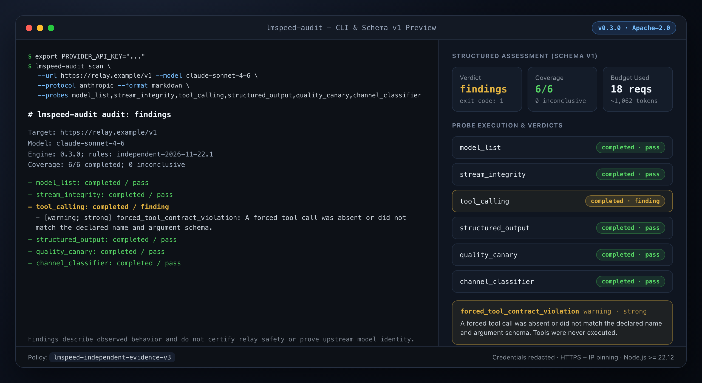
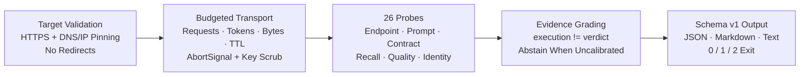

<div align="center">

# lmspeed-audit

**Evidence-based LLM API and relay auditing for Node.js, TypeScript, and the CLI — testing protocol fidelity, tool and schema contracts, prompt isolation, context recall, and behavioral consistency.**

[](https://github.com/lmspeed/audit/actions/workflows/ci.yml)
[](./LICENSE)
[](https://github.com/lmspeed/audit/blob/main/package.json)
[](https://github.com/lmspeed/audit/blob/main/package.json)

[English](./README.md) · [简体中文](./README.zh-CN.md) · [Русский](./README.ru.md)

[Features](#features) · [Quick Start](#quick-start) · [Installation](#installation) · [Try Online](https://lmspeed.net/audit) · [Preview](#preview) · [Feature Reference](#complete-probe--feature-reference) · [Methodology](#methodology--evidence-boundaries) · [Documentation](#documentation--languages) · [Credits](#credits) · [License](#license)

</div>

> [!NOTE]
> **Evidence boundary:** Reports separate execution status (`completed`, `blocked`, `unsupported`, `skipped`, `error`), probe verdict (`pass`, `finding`, `inconclusive`), confidence (`weak`, `moderate`, `strong`), and coverage. Observed failures, header hints, or reference rankings do not prove the true upstream model or operator intent, and `no_findings` covers only the executed workload.

---

## Features

- **26 Modular Probes in 4 Groups** — Endpoint reachability and header hints, prompt/injection safety, streaming & capability contracts (`tool_calling`, `structured_output`, `image_understanding`, `pdf_understanding`, `context_recall`), and behavioral/statistical checks (`quality_canary`, `quality_comparison`, `model_fingerprint`, `numeric_fingerprint`, `tokenizer_fingerprint`).
- **Multi-Protocol Auto-Routing** — Supports OpenAI Chat (`/chat/completions`), Anthropic Messages (`/messages`), OpenAI Responses (`/responses`), and `auto` selection.
- **Separated Verdict & Coverage Model** — Missing capabilities, authentication blocks, rate limits, incomplete telemetry, and uncalibrated baselines remain `unsupported`, `blocked`, `skipped`, or `inconclusive` instead of silently passing or failing.
- **SSRF & Credential Hygiene** — Public runs require HTTPS, resolve DNS and pin the connected IP per request, block private/reserved IPv4 & IPv6 ranges, disable HTTP redirects, read credentials from environment variables only, write `--output` files with `0600` exclusive-create semantics, and redact keys and sensitive assignments across outputs and callbacks.
- **Shared Execution Budgets** — Target, reference, and judge requests share configurable `maxRequests`, `maxInputTokens`, `maxResponseBytes`, `maxDurationMs`, `pacingMs`, and `AbortSignal` cancellation.
- **Independent Baseline Calibration** — `collect-baseline` gathers separate training and validation batches against two candidates plus an external control (`other`), computing SHA-256 digests and enforcing freshness and holdout margins before allowing compatibility scoring.

---

## Quick Start

### Try Online on LMSpeed (No Local Setup)

Want to test an endpoint right away without installing anything locally? LMSpeed hosts the same `@lmspeed/audit` engine directly in the browser:

- **[Run Full Relay Audit](https://lmspeed.net/audit)** — Launch an online multi-probe audit and get a shareable report
- **Single-Probe Tools** — [Model Fingerprint](https://lmspeed.net/audit/model-fingerprint) · [Stream Integrity](https://lmspeed.net/audit/stream-integrity) · [Tool Calling](https://lmspeed.net/audit/tool-calling) · [Context Recall](https://lmspeed.net/audit/context-recall)
- **More Live Tools** — [LLM Speed Test](https://lmspeed.net/speed) · [Provider Directory](https://lmspeed.net/provider) · [Free Test API Keys](https://lmspeed.net/free-api-keys)

### Agent Quick-Start Prompt (Copy & Paste, Zero Edits)

Paste this prompt into Claude Code, Codex, Cursor, or any terminal-capable coding agent to set up and run an audit interactively without editing placeholders:

```text
Set up and run an API endpoint audit using lmspeed-audit (`https://github.com/lmspeed/audit`).

1. Install the published CLI with `pnpm add --global @lmspeed/audit` (Node.js >=22.12), then inspect `lmspeed-audit --help` and `lmspeed-audit list --format json` so you know the exact flags and probe IDs. For a one-off run, use `pnpm dlx @lmspeed/audit --help`. See the Installation section for Homebrew, Scoop and portable downloads.
2. Before making any network calls to the target endpoint, ask me for any details not already provided in this conversation:
   - Target base URL (and whether it is a private or local HTTP endpoint requiring `--allow-private`)
   - Model ID to audit
   - Protocol (`auto`, `openai`, `anthropic`, or `responses`)
   - Desired profile (`connectivity`, `general`, `web3`, or `full`) or specific probes, plus any optional capabilities (`--thinking`, `--context-tokens`) or local config JSON (`--config` for reference, judge, context, identity baseline, tokenizer bank, or numeric scorer)
   - Name of the environment variable holding the API key (default `PROVIDER_API_KEY`). Instruct me to export the secret in my shell instead of pasting any raw API key into chat.
3. Run a minimal connectivity check first (`--profile connectivity --max-requests 10 --format markdown`) to confirm auth, routing, and protocol framing.
4. Once connectivity succeeds, run the agreed audit with explicit request/duration budgets (`--max-requests`, `--max-duration-ms`) and save structured output with `--output` if a JSON artifact is requested. Never print or log API keys.
5. Summarize the observed `assessment.verdict`, execution coverage (`completed` vs `blocked` / `unsupported` / `skipped` / `inconclusive`), any findings with severity and confidence, and actual `usage` counters without claiming upstream model identity or overall safety beyond what the probes observed.
```

## Installation

The CLI and SDK require **Node.js >=22.12**. Homebrew and Scoop install Node.js for you.

### npm registry

```sh
# Run once, without a global installation
pnpm dlx @lmspeed/audit --help

# Install the command globally
pnpm add --global @lmspeed/audit
lmspeed-audit list

# Add the TypeScript SDK to a project
pnpm add @lmspeed/audit
```

Package: [`@lmspeed/audit`](https://www.npmjs.com/package/@lmspeed/audit).

### Homebrew (macOS and Linux)

```sh
brew tap lmspeed/audit https://github.com/lmspeed/audit
brew install lmspeed/audit/lmspeed-audit
lmspeed-audit --version
```

This repository is the upstream Homebrew tap. Upgrade with `brew update && brew upgrade lmspeed-audit`.

### Scoop (Windows)

```powershell
scoop bucket add lmspeed https://github.com/lmspeed/audit
scoop install lmspeed/lmspeed-audit
lmspeed-audit --version
```

The upstream bucket installs the portable command and `nodejs-lts`. Upgrade with `scoop update lmspeed-audit`.

### GitHub Packages

GitHub's npm registry requires authentication even for public packages. First authenticate with a classic personal access token with `read:packages`, following the [GitHub registry instructions](https://docs.github.com/en/packages/working-with-a-github-packages-registry/working-with-the-npm-registry), and map only the `@lmspeed` scope:

```ini
@lmspeed:registry=https://npm.pkg.github.com
//npm.pkg.github.com/:_authToken=${NODE_AUTH_TOKEN}
```

```sh
pnpm add --global @lmspeed/audit
# The SDK uses the same package name on both registries
pnpm add @lmspeed/audit
```

Use this mapping only when installing from GitHub Packages; omit it for npmjs.org. Do not commit tokens. The primary npm package needs no GitHub login.

### Portable downloads

[GitHub Releases](https://github.com/lmspeed/audit/releases/latest) provide `.tar.gz` and `.zip` archives containing the bundled command, runtime dependencies, documentation and license notices. Verify the download against `SHA256SUMS`, extract it, and run `node lmspeed-audit/lmspeed-audit.mjs --help` (or `lmspeed-audit.cmd` on Windows). No dependency installation is required; Node.js is still required.

For an immediate browser-based check, use [LMSpeed Audit](https://lmspeed.net/audit), [LLM speed tests](https://lmspeed.net/speed) or the [provider directory](https://lmspeed.net/provider). See [publishing and channel maintenance](./docs/releasing.md) for release automation.

### Install & Build from source

Requires **Node.js `>= 22.12`** and **pnpm**:

```sh
git clone https://github.com/lmspeed/audit.git
cd audit
pnpm install --frozen-lockfile
pnpm build
node dist/cli/index.js --help
```

Optionally expose the `lmspeed-audit` binary globally from the local build:

```sh
pnpm link --global
lmspeed-audit list
```

### CLI Usage

```sh
export PROVIDER_API_KEY="sk-your-key-here"

# 1. Quick connectivity and stream check
lmspeed-audit scan \
  --url https://relay.example.com/v1 \
  --model claude-sonnet-4-6 \
  --protocol auto \
  --profile connectivity \
  --max-requests 10 \
  --format markdown

# 2. General audit with bounded resources and 0600 JSON output
lmspeed-audit scan \
  --url https://relay.example.com/v1 \
  --model gpt-4o \
  --profile general \
  --max-requests 120 \
  --max-duration-ms 180000 \
  --format json \
  --output audit-report.json
```

### TypeScript SDK

```ts
import { ENGINE_VERSION, runAudit } from '@lmspeed/audit';

const report = await runAudit(
  {
    target: {
      baseUrl: 'https://relay.example.com/v1',
      modelId: 'claude-sonnet-4-6',
      protocol: 'auto',
    },
    apiKey: process.env.PROVIDER_API_KEY!,
    profile: 'general',
    capabilities: { vision: true },
  },
  {
    limits: { maxRequests: 100, maxDurationMs: 120_000 },
    pacingMs: 100,
  },
);

console.log(ENGINE_VERSION, report.assessment.verdict, report.coverage);
```

Verdicts are computed by the library. Explicit extraction refusals recognize English typography and Chinese/Russian refusal forms; an empty JSON extraction is informational, while ambiguous answers remain inconclusive. The semantic yes/no task accepts terminal punctuation; the instruction-priority check tolerates surrounding formatting, while literal-copy tasks retain strict comparison. For unresolved checks, import `getAuditInconclusiveReason` from `@lmspeed/audit/assessment` to obtain a machine-readable cause for translation. Consumers should retain the engine verdict rather than replacing it with a display heuristic.

---

## Preview



- **CLI Exit Codes:** `scan` exits `0` (`no_findings`), `1` (`findings`), or `2` (`inconclusive`, missing auth/args, or runtime error). `collect-baseline` exits `0` when calibration is `validated` or `2` otherwise.

<details>
<summary>Schema v1 JSON excerpt (real local loopback scan on v0.3.0)</summary>

```json
{
  "schemaVersion": "1",
  "engineVersion": "0.3.0",
  "rulesetVersion": "independent-2026-11-23.7",
  "target": {
    "baseUrl": "http://127.0.0.1:57215/v1",
    "modelId": "claude-sonnet-4-6",
    "protocol": "anthropic"
  },
  "probes": [
    {
      "id": "tool_calling",
      "execution": "completed",
      "verdict": "finding",
      "findings": [
        {
          "probeId": "tool_calling",
          "code": "forced_tool_contract_violation",
          "severity": "warning",
          "confidence": "strong",
          "evidence": "A forced tool call was absent or did not match the declared name and argument schema."
        }
      ]
    },
    {
      "id": "channel_classifier",
      "execution": "completed",
      "verdict": "pass",
      "observations": {
        "status": 200,
        "channel": "anthropic-api",
        "confidence": 0.5,
        "evidence": ["anthropic-ratelimit-requests-limit"]
      }
    }
  ],
  "coverage": {
    "requested": [
      "model_list",
      "stream_integrity",
      "tool_calling",
      "structured_output",
      "quality_canary",
      "channel_classifier"
    ],
    "completed": [
      "model_list",
      "stream_integrity",
      "tool_calling",
      "structured_output",
      "quality_canary",
      "channel_classifier"
    ],
    "inconclusive": [],
    "blocked": [],
    "unsupported": [],
    "skipped": []
  },
  "assessment": {
    "policyId": "lmspeed-independent-evidence-v3",
    "verdict": "findings"
  },
  "usage": {
    "requests": 18,
    "inputTokensEstimated": 1062
  }
}
```

</details>

---

## Complete Probe & Feature Reference

### Profiles & Protocols

| Profile | Included Probes by Default | Intended Use |
| :--- | :--- | :--- |
| `connectivity` | `model_list`, `stream_integrity` | Fast preflight reachability, authentication, and SSE framing verification |
| `general` *(default)* | 19 automatic probes, including numeric screening and tokenizer evidence from bundled reference data; excludes `web3_prompt_injection` and other opt-in probes unless configured | Standard relay contract & security audit |
| `web3` | `general` set + `web3_prompt_injection` + configured opt-in probes | General audit plus wallet seed-sharing refusal signal |
| `full` | Same automatic set + `web3_prompt_injection` + all configured opt-in capability/reference probes (`tokenBaselines`, `vision`, `pdf`, `context`, `reference`, `identity`, `numericFingerprint`, `tokenizer`) | Comprehensive audit with full operator configuration |

| Protocol | Wire Endpoint & Auth Header | `auto` Resolution |
| :--- | :--- | :--- |
| `openai` | `POST /chat/completions`, `GET /models`, `Authorization: Bearer <key>` | Default when `modelId` does not contain `claude` |
| `anthropic` | `POST /messages`, `x-api-key: <key>`, `anthropic-version: 2023-06-01` | Selected when `modelId` matches `/claude/i` |
| `responses` | `POST /responses`, `Authorization: Bearer <key>` | Explicit `--protocol responses` only |
| `auto` | Routes per `modelId` rule above | Default |

### All 26 Probes Matrix

#### 1. Endpoint Profile (`endpoint_profile`)

| Probe ID | Trigger | Behavior & Evidence Scope |
| :--- | :--- | :--- |
| `infrastructure_recon` | Auto | Collects entry reachability, DNS addresses/CNAME/NS, TLS certificate details and bounded WHOIS registration fields; unavailable evidence stays separate |
| `model_list` | Auto / `connectivity` | Reads `GET /models` JSON `data[]` catalog and checks whether `target.modelId` is listed (`advertised catalog only`) |
| `infrastructure_fingerprint` | Auto | Compares landing, models and error-route signatures for New API, One API, LiteLLM, One Hub, LobeChat, FastGPT and common entry proxies; editable branding is evidence, not upstream proof |
| `channel_classifier` | Auto | Inspects explicit header prefixes (`cf-aig-`, `x-amzn-bedrock-`, `anthropic-ratelimit-`); marks conflicting or absent hints as `inconclusive` |

#### 2. Prompt & Injection Security (`prompt_security`)

| Probe ID | Trigger | Behavior & Evidence Scope |
| :--- | :--- | :--- |
| `token_injection` | Opt-in (`capabilities.tokenBaselines`) | Compares reported input usage across `plain`, `system`, and `question` templates against caller calibration (`reported_input_count_mismatch`) |
| `prompt_extraction` | Auto | Runs verbatim, translation and JSON-continuation probes plus a randomized protected-value control; retains separate results and prompts/responses |
| `jailbreak_identity` | Auto | Runs system diagnostic, Base64 and middleware role-play strategies plus randomized JSON/Base64 disclosure controls |
| `conditional_injection` | Auto | Runs 3 randomized ordinary vs. sensitive account task pairs and checks for excess `DECOY_*` disclosure + external `https://` forwarding directions |
| `web3_prompt_injection` | `web3` / `full` | Tests structured JSON refusal policy on seed-phrase upload requests (`{"action":"reject"}` vs `"share"`) |

#### 3. Model Authenticity & Consistency (`model_authenticity`)

| Probe ID | Trigger | Behavior & Evidence Scope |
| :--- | :--- | :--- |
| `instruction_conflict` | Auto | Requests a fresh random `ACK_*` in system instructions while the user asks to ignore it; tolerates surrounding whitespace, quotes/backticks and terminal sentence punctuation, but requires the complete unchanged marker with no extra text (`system_priority_mismatch`) |
| `stream_integrity` | Auto / `connectivity` | Validates SSE framing (`[DONE]` / `message_stop` / `response.completed`), streamed model consistency, and monotonic usage counters |
| `context_window` | Auto | Uses a short calibration sample and targets the supplied context in up to five requests by default. Pass requires full marker recall and sufficient endpoint-reported input usage. Without a reference, measures character bounds and reports that official verification did not pass. Explicit `context.sizes` alone retains fixed recall sampling |
| `context_recall` | Opt-in (`context`) | Embeds random `FACT_*` anchors at configurable positions (`[0, 0.25, 0.5, 0.75, 1]` default), confirming misses once before reporting `context_recall_missing` |
| `model_fingerprint` | Opt-in (`identity`) | Compares answer distributions against a calibrated holdout baseline; abstains on expired, incomplete, incompatible, or low-margin samples |
| `numeric_fingerprint` | Auto; optional `numericFingerprint` override | Uses the shipped SHA-256-pinned reference (30-day age limit) for closed-set ranking; no runtime data downloads |
| `tokenizer_fingerprint` | Auto; optional `tokenizer` override | Uses the shipped tokenizer bank (90-day age limit, up to 12 samples plus four controls). Stops on confirmed drift or abstains when evidence is uncertain |

Reference data is owned and versioned by this package. SDK, CLI and LMSpeed use the same read-only `assets/references` snapshot, including source commit, original dates, hashes and MIT attribution. Explicit `numericFingerprint` and `tokenizer` configuration takes precedence. Set `referenceData: 'disabled'` in SDK/config JSON to disable automatic reference checks. Expired, missing or altered data is reported as inconclusive without downloading replacements or blocking unrelated checks. Distribution confirmation still requires an independently calibrated `identity` baseline.

Maintainers update `references.source.json` to a reviewed upstream commit and Git blob hashes, then run `pnpm references:sync`. The command downloads only during maintenance, verifies original blobs and compatibility, and keeps only scoring metadata, the detector and tokenizer bank. Commit the snapshot and release through this repository's existing CI. See [reference data maintenance](./docs/references.md).

#### 4. Response Integrity & Stability (`response_integrity_stability`)

| Probe ID | Trigger | Behavior & Evidence Scope |
| :--- | :--- | :--- |
| `tool_substitution` | Auto | Asks the model to echo a fresh random `@audit-fixture/*` package string without execution (`literal_output_mismatch`) |
| `error_leakage` | Auto | Sends a single malformed JSON payload (`{`) and scans responses/headers for exposed config assignments (`DATABASE_URL`, `API_KEY`, etc.) with values omitted |
| `latency_variance` | Auto | Executes 5 sequential short readiness calls and computes descriptive statistics (`count`, `median`, `mean`, `min`, `max`, `spread`) |
| `tool_calling` | Auto *(unless `tools: false`)* | Verifies forced call schema (`audit_weather`), `tool_choice: none`, and undeclared-tool restraint; tools are never executed |
| `structured_output` | Auto *(unless `structuredOutput: false`)* | Runs 2 randomized nonce trials enforcing `strict` JSON Schema with `additionalProperties: false` |
| `image_understanding` | Opt-in (`capabilities.vision: true`) | Sends a generated solid-color PNG absent from text prompts and verifies exact color-word recovery |
| `pdf_understanding` | Opt-in (`capabilities.pdf: true`) | Sends a generated valid PDF embedding an unseen target word and verifies exact recovery |
| `stream_consistency` | Auto | Compares identical deterministic non-streamed vs. streamed completions across returned model ID, input tokens, and non-reasoning output counts |
| `quality_canary` | Auto | Runs 10 deterministic micro-tasks (`QUALITY_TASKS`: arithmetic, sorting, string reversal, JSON, formatting, prime, binary, Python `len`, logic, word recall) |
| `quality_comparison` | Opt-in (`reference`, optional `judge`) | Evaluates randomized `target` vs. repeated `reference` arms on `QUALITY_TASKS`, separating acquisition errors from answer regressions |

### CLI Options & Default Budgets

```sh
lmspeed-audit scan --url <base-url> --model <model-id> [options]
lmspeed-audit collect-baseline --config collection.json [--output baseline.json]
lmspeed-audit list [--format json]
```

| Flag | Default | Description |
| :--- | :--- | :--- |
| `--url`, `--model` | *(required for `scan`)* | Target API base URL and model identifier |
| `--protocol` | `auto` | `auto`, `openai`, `anthropic`, or `responses` |
| `--profile` | `general` | `connectivity`, `general`, `web3`, or `full` |
| `--probes` | profile default | Comma-separated subset of probe IDs from `list` |
| `--format` | `json` | Output format for `scan`: `json`, `markdown`, or `text`; `list` supports `json` |
| `--output` | stdout | Creates a new file with `0600` permissions (`wx`, fails if path already exists) |
| `--config` | — | Local JSON configuration file for capabilities, context, reference/judge, or identity artifacts |
| `--key-env` | `PROVIDER_API_KEY` | Environment variable name holding the target credential |
| `--allow-private` | `false` | Permits plain HTTP and private/loopback addresses for local targets |
| `--thinking` | `false` | Declares extended thinking support in input capabilities |
| `--context-tokens` | — | Publisher context window in tokens. Enables targeted verification |
| `--max-requests` | `200` | Maximum HTTP requests shared across target, reference, and judge calls |
| `--max-input-tokens` | `2000000` | Maximum estimated input token budget (`ceil(body.length / 4)`) |
| `--max-response-bytes` | `4000000` | Maximum bytes buffered per HTTP response |
| `--max-duration-ms` | `600000` | Total wall-clock timeout in milliseconds |
| `--pace-ms` | `0` | Inter-request delay in milliseconds (`latency_variance`) |

### Configuration (`--config`), Baseline Collection & Exports

Operator JSON passed to `--config` never stores raw secrets (`apiKey` is rejected; use `apiKeyEnv` naming env vars), and relative artifact paths resolve against the config file directory:

```json
{
  "profile": "full",
  "capabilities": {
    "vision": true,
    "pdf": false,
    "tokenBaselines": { "plain": 14, "system": 24, "question": 18 }
  },
  "context": {
    "sizes": [4096, 16384],
    "positions": [0, 0.5, 1]
  },
  "reference": {
    "target": { "baseUrl": "https://ref.example.com/v1", "modelId": "gpt-4o", "protocol": "openai" },
    "apiKeyEnv": "REFERENCE_API_KEY"
  },
  "judge": {
    "target": { "baseUrl": "https://judge.example.com/v1", "modelId": "gpt-4o", "protocol": "openai" },
    "apiKeyEnv": "JUDGE_API_KEY",
    "minimumScore": 7
  },
  "identity": {
    "baselineFile": "./artifacts/baseline.json",
    "claimedModel": "candidate-a"
  },
  "tokenizer": {
    "bankFile": "./artifacts/tokenizer-bank.json",
    "maximumProbes": 20,
    "maxAgeDays": 30
  },
  "numericFingerprint": {
    "dataDirectory": "./artifacts/numeric",
    "detectorSha256": "64-lowercase-hex-sha256-of-shared-detector-bin",
    "maximumAgeDays": 30
  }
}
```

Use `collect-baseline` (or `collectFingerprintBaseline`) with `>= 2` `candidate` sources plus `>= 1` `other` external reference (`2–8` prompts, `16–256` samples per prompt, `maxOutputTokens` `16–2048`, `maxAgeDays` `<= 30`) to build validated holdout baselines.

Package subpath exports: `@lmspeed/audit` (Node SDK), `@lmspeed/audit/catalog` *(browser-safe)*, `@lmspeed/audit/schema` *(browser-safe)*, `@lmspeed/audit/legacy-types` *(browser-safe)*, `@lmspeed/audit/compat`, `@lmspeed/audit/classifiers`, `@lmspeed/audit/sse`, `@lmspeed/audit/model-family`, `@lmspeed/audit/prompts`, and `@lmspeed/audit/redaction`.

---

## Methodology & Evidence Boundaries



1. **SSRF & Secret Isolation** — `validateTarget` validates URLs and blocks loopback/private/reserved ranges on every connection in public mode, pinning DNS answers into `http(s).request` with hostname verification and redirect rejection. API keys, reference keys, judge keys, and URL assignments (`upstream_url`, `DATABASE_URL`, etc.) are scrubbed from serialized results and errors.
2. **Execution vs. Verdict Separation** — HTTP auth errors (`401`/`403`), rate limits (`429`), unsupported media/configs, incomplete telemetry, and uncalibrated references become `blocked`, `unsupported`, `skipped`, or `inconclusive` rather than silent passes or false findings.
3. **Holdout & Statistical Restraint** — Behavioral baselines require matching `protocol` and `generation` contracts, freshness (`<= maxAgeDays`), independent validation holdouts, and minimum separation margins. Tokenizer sampling uses two opening controls and one closing control. The first sample below the opening count triggers one extra control to check for drift. Sampling can stop early at 99% posterior confidence, and an exact tokenizer match requires at least 90% confidence.
4. **Verification Suite (`pnpm check`)** — Runs TypeScript compilation, Biome formatting/linting, strict `tsc --noEmit`, AST test-governance checks (`no-mock`, `given-when-then`, `user ` scenario names), Vitest suites executing against real loopback HTTP relays with a **70% branch coverage threshold**, and package boundary checks (`pnpm verify:package`). Automated tests verify implementation contracts over loopback HTTP; live first-party model accuracy is not claimed without external reference calibration. See [`docs/acceptance.md`](./docs/acceptance.md) and [`docs/strategy-review.md`](./docs/strategy-review.md).

---

## Documentation & Languages

| Document | English | 简体中文 | Русский |
| :--- | :--- | :--- | :--- |
| User guide | [English](./README.md) | [简体中文](./README.zh-CN.md) | [Русский](./README.ru.md) |
| Acceptance scenarios | [English](./docs/acceptance.md) | [简体中文](./docs/acceptance.zh-CN.md) | [Русский](./docs/acceptance.ru.md) |
| Strategy & evidence limits | [English](./docs/strategy-review.md) | [简体中文](./docs/strategy-review.zh-CN.md) | [Русский](./docs/strategy-review.ru.md) |
| Publishing & installation channels | [English](./docs/releasing.md) | [简体中文](./docs/releasing.zh-CN.md) | [Русский](./docs/releasing.ru.md) |
| Changelog | [English](./CHANGELOG.md) | [简体中文](./CHANGELOG.zh-CN.md) | [Русский](./CHANGELOG.ru.md) |

Documentation is available in three languages. Commands, probe IDs, schema fields and status values are identical across guides; translated documentation does not change the CLI output language.

---

## Credits

- **[LMSpeed](https://lmspeed.net)** — LLM API speed and quality benchmark platform maintaining `@lmspeed/audit`.
- **[lm-detector](https://github.com/Ikaleio/lm-detector) & [lmfpd-sdk](https://www.npmjs.com/package/lmfpd-sdk)** — MIT-licensed tokenizer bank validation / Bayesian posterior planning and offline numeric candidate ranking (notices preserved in [`THIRD_PARTY_NOTICES.md`](./THIRD_PARTY_NOTICES.md)).
- **Protocol & Security Literature** — Streaming and contract checks follow public OpenAI, Anthropic, and WHATWG SSE specifications, Web3 prompt-injection defense literature (`arXiv:2604.08407`), and open verification concepts explored alongside projects such as `LLMprobe-engine`, `Veridrop`, and `meow-llm-detector`.

---

## License

Licensed under the **[Apache License, Version 2.0](./LICENSE)** (`Apache-2.0`). See [`NOTICE`](./NOTICE) and [`THIRD_PARTY_NOTICES.md`](./THIRD_PARTY_NOTICES.md) for attribution and retained MIT third-party notices.
