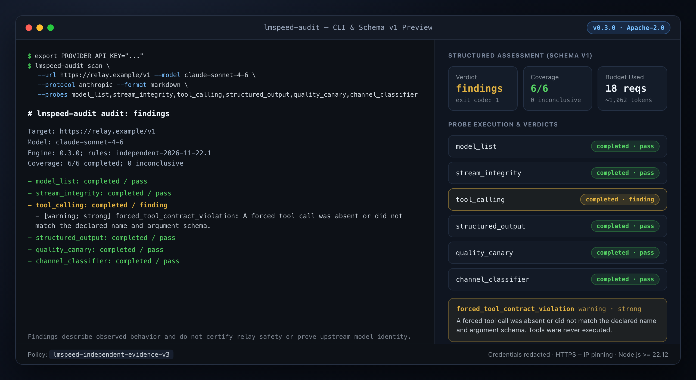
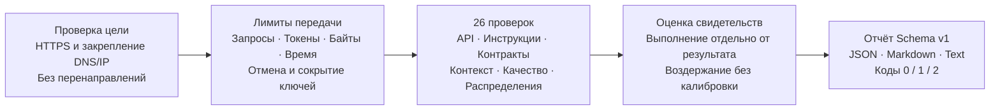

<div align="center">

# lmspeed-audit

**Аудит LLM API и промежуточных API на основе наблюдаемых данных: CLI для Node.js и SDK для TypeScript. Проверяйте соблюдение протоколов, контракты инструментов и схем, изоляцию инструкций, воспроизведение контекста и согласованность поведения.**

[](https://github.com/lmspeed/audit/actions/workflows/ci.yml)
[](./LICENSE)
[](https://github.com/lmspeed/audit/blob/main/package.json)
[](https://github.com/lmspeed/audit/blob/main/package.json)

[English](./README.md) · [简体中文](./README.zh-CN.md) · [Русский](./README.ru.md)

[Возможности](#возможности) · [Быстрый старт](#быстрый-старт) · [Установка](#установка) · [Проверить онлайн](https://lmspeed.net/ru/audit) · [Пример отчёта](#пример-отчёта) · [Справочник](#полный-справочник-проверок-и-возможностей) · [Методология](#методология-и-границы-выводов) · [Документация](#документация-и-языки) · [Благодарности](#благодарности) · [Лицензия](#лицензия)

</div>

> [!NOTE]
> **Границы выводов:** отчёт отдельно отражает состояние выполнения (`completed`, `blocked`, `unsupported`, `skipped`, `error`), результат проверки (`pass`, `finding`, `inconclusive`), уверенность (`weak`, `moderate`, `strong`) и покрытие. Ошибки, признаки в заголовках и ранжирование кандидатов не доказывают подлинность исходной модели или намерения оператора. `no_findings` относится только к выполненной нагрузке.

---

## Возможности

- **26 модульных проверок в 4 группах** — доступность API и признаки в заголовках, безопасность инструкций и инъекции, потоковая передача и контракты возможностей (`tool_calling`, `structured_output`, `image_understanding`, `pdf_understanding`, `context_recall`), а также поведенческие и статистические проверки (`quality_canary`, `quality_comparison`, `model_fingerprint`, `numeric_fingerprint`, `tokenizer_fingerprint`).
- **Несколько протоколов** — OpenAI Chat (`/chat/completions`), Anthropic Messages (`/messages`), OpenAI Responses (`/responses`) и выбор `auto`.
- **Раздельный учёт результата и покрытия** — недоступные возможности, ошибки авторизации, ограничения частоты, неполные метрики и некалиброванные эталоны сохраняют статусы `unsupported`, `blocked`, `skipped` или `inconclusive`.
- **Защита от SSRF и сокрытие секретов** — публичный режим требует HTTPS, разрешает DNS и закрепляет IP при каждом запросе, блокирует частные и зарезервированные диапазоны IPv4/IPv6 и запрещает HTTP-перенаправления. CLI читает ключи из переменных окружения, создаёт файлы `--output` эксклюзивно с правами `0600` и скрывает ключи и чувствительные значения в отчётах и обратных вызовах.
- **Общие лимиты ресурсов** — запросы к целевому API, эталону и модели-судье используют общие `maxRequests`, `maxInputTokens`, `maxResponseBytes`, `maxDurationMs`, `pacingMs` и отмену через `AbortSignal`.
- **Независимая калибровка эталонов** — `collect-baseline` собирает отдельные обучающие и проверочные выборки для двух кандидатов и внешнего контроля (`other`), вычисляет SHA-256 и проверяет свежесть данных и разделимость на отложенной выборке.

---

## Быстрый старт

### Проверка онлайн на LMSpeed без локальной установки

Веб-интерфейс LMSpeed использует тот же движок `@lmspeed/audit`:

- **[Запустить аудит API](https://lmspeed.net/ru/audit)** — несколько проверок и отчёт, которым можно поделиться.
- **Отдельные проверки** — [отпечаток модели](https://lmspeed.net/ru/audit/model-fingerprint) · [целостность потока](https://lmspeed.net/ru/audit/stream-integrity) · [вызовы инструментов](https://lmspeed.net/ru/audit/tool-calling) · [воспроизведение контекста](https://lmspeed.net/ru/audit/context-recall).
- **Другие инструменты** — [скорость LLM API](https://lmspeed.net/ru/speed) · [каталог провайдеров](https://lmspeed.net/ru/provider) · [бесплатные тестовые API-ключи](https://lmspeed.net/ru/free-api-keys).

### Готовая инструкция для агента

Скопируйте текст в Claude Code, Codex, Cursor или другой агент с доступом к терминалу. Заполнители редактировать не нужно:

```text
Установи lmspeed-audit (https://github.com/lmspeed/audit) и помоги проверить LLM API.

1. Установи опубликованный CLI командой `pnpm add --global @lmspeed/audit` (Node.js >=22.12). Сначала прочитай `lmspeed-audit --help` и `lmspeed-audit list --format json`, чтобы использовать точные параметры и ID проверок. Для разового запуска подойдёт `pnpm dlx @lmspeed/audit --help`. Homebrew, Scoop и переносимые архивы описаны в разделе установки.
2. До любых сетевых запросов к целевому API уточни только те сведения, которых ещё нет в разговоре:
   - Базовый URL API; нужен ли `--allow-private` для локального или частного HTTP-адреса.
   - ID проверяемой модели.
   - Протокол: `auto`, `openai`, `anthropic` или `responses`.
   - Профиль: `connectivity`, `general`, `web3`, `full` либо конкретные проверки; дополнительные возможности `--thinking`, `--context-tokens` или локальный JSON `--config` для эталона, судьи, контекста и данных отпечатков.
   - Имя переменной окружения с ключом, по умолчанию `PROVIDER_API_KEY`. Попроси меня экспортировать секрет в терминале, а не отправлять сам ключ в чат.
3. Сначала выполни небольшую проверку подключения: `--profile connectivity --max-requests 10 --format markdown`. Убедись, что авторизация, маршрутизация и потоковый протокол работают.
4. Затем выполни согласованный аудит с явными лимитами `--max-requests` и `--max-duration-ms`. Если нужен JSON-файл, используй `--output`. Не выводи и не записывай API-ключи в логи.
5. Подведи итоги по `assessment.verdict`, покрытию (`completed`, `blocked`, `unsupported`, `skipped`, `inconclusive`), находкам с серьёзностью и уверенностью и фактическим счётчикам `usage`. Не делай неподтверждённых выводов о подлинности модели или общей безопасности сервиса.
```

## Установка

CLI и SDK требуют **Node.js >=22.12**. Homebrew и Scoop устанавливают Node.js автоматически.

### Реестр npm

```sh
# Разовый запуск без глобальной установки
pnpm dlx @lmspeed/audit --help

# Глобальная установка CLI
pnpm add --global @lmspeed/audit
lmspeed-audit list

# Установка TypeScript SDK в проект
pnpm add @lmspeed/audit
```

Пакет: [`@lmspeed/audit`](https://www.npmjs.com/package/@lmspeed/audit).

### Homebrew: macOS и Linux

```sh
brew tap lmspeed/audit https://github.com/lmspeed/audit
brew install lmspeed/audit/lmspeed-audit
lmspeed-audit --version
```

Этот репозиторий служит официальным tap проекта. Обновление: `brew update && brew upgrade lmspeed-audit`.

### Scoop: Windows

```powershell
scoop bucket add lmspeed https://github.com/lmspeed/audit
scoop install lmspeed/lmspeed-audit
lmspeed-audit --version
```

Bucket проекта устанавливает переносимую команду и `nodejs-lts`. Обновление: `scoop update lmspeed-audit`.

### GitHub Packages

Реестр npm от GitHub требует авторизацию даже для публичных пакетов. Создайте классический personal access token с разрешением `read:packages` по [инструкции GitHub](https://docs.github.com/en/packages/working-with-a-github-packages-registry/working-with-the-npm-registry) и настройте только scope `@lmspeed`:

```ini
@lmspeed:registry=https://npm.pkg.github.com
//npm.pkg.github.com/:_authToken=${NODE_AUTH_TOKEN}
```

```sh
pnpm add --global @lmspeed/audit
pnpm add @lmspeed/audit
```

Эта настройка нужна только для GitHub Packages; для npmjs.org не добавляйте её. Не коммитьте токены. Установка основного пакета из npm не требует входа в GitHub.

### Переносимые архивы

В [GitHub Releases](https://github.com/lmspeed/audit/releases/latest) доступны `.tar.gz` и `.zip` с командой, зависимостями, документацией и лицензиями. Сверьте файл с `SHA256SUMS`, распакуйте и запустите `node lmspeed-audit/lmspeed-audit.mjs --help` либо `lmspeed-audit.cmd` в Windows. Установка зависимостей не нужна; Node.js всё ещё необходим.

Для немедленной проверки используйте [LMSpeed Audit](https://lmspeed.net/ru/audit), [тест скорости](https://lmspeed.net/ru/speed) или [каталог провайдеров](https://lmspeed.net/ru/provider). Автоматизация выпуска описана в [руководстве по публикации](./docs/releasing.ru.md).

### Сборка из исходников

Нужны **Node.js >=22.12** и **pnpm**:

```sh
git clone https://github.com/lmspeed/audit.git
cd audit
pnpm install --frozen-lockfile
pnpm build
node dist/cli/index.js --help
```

При необходимости сделайте локальную сборку доступной как глобальную команду:

```sh
pnpm link --global
lmspeed-audit list
```

### Использование CLI

```sh
export PROVIDER_API_KEY="sk-your-key-here"

# Подключение и потоковый протокол
lmspeed-audit scan \
  --url https://relay.example.com/v1 \
  --model claude-sonnet-4-6 \
  --protocol auto \
  --profile connectivity \
  --max-requests 10 \
  --format markdown

# Общий аудит с лимитами и новым JSON-файлом с правами 0600
lmspeed-audit scan \
  --url https://relay.example.com/v1 \
  --model gpt-4o \
  --profile general \
  --max-requests 120 \
  --max-duration-ms 180000 \
  --format json \
  --output audit-report.json
```

### TypeScript SDK

```ts
import { ENGINE_VERSION, runAudit } from '@lmspeed/audit';

const report = await runAudit(
  {
    target: {
      baseUrl: 'https://relay.example.com/v1',
      modelId: 'claude-sonnet-4-6',
      protocol: 'auto',
    },
    apiKey: process.env.PROVIDER_API_KEY!,
    profile: 'general',
    capabilities: { vision: true },
  },
  {
    limits: { maxRequests: 100, maxDurationMs: 120_000 },
    pacingMs: 100,
  },
);

process.stdout.write(
  JSON.stringify({ version: ENGINE_VERSION, verdict: report.assessment.verdict, coverage: report.coverage }),
);
```

Решения принимает библиотека. Распознаются типографские апострофы в английских отказах, а также китайские и русские формы отказа. Пустое JSON-извлечение считается информационным результатом; неоднозначный ответ остаётся неопределённым. В смысловом задании yes/no допустим конечный знак препинания, а точные строковые задания сохраняют строгое сравнение. Для нерешённых проверок импортируйте `getAuditInconclusiveReason` из `@lmspeed/audit/assessment`, чтобы получить машинный код причины для перевода. Потребители должны сохранять решение движка, не заменяя его логикой отображения.

---

## Пример отчёта



- **Коды завершения:** `scan` возвращает `0` при `no_findings`, `1` при `findings`, `2` при `inconclusive`, отсутствии авторизации/аргументов или ошибке выполнения. `collect-baseline` возвращает `0` для калибровки `validated`, иначе `2`.

<details>
<summary>Фрагмент Schema v1: реальная локальная проверка на v0.3.0</summary>

```json
{
  "schemaVersion": "1",
  "engineVersion": "0.3.0",
  "rulesetVersion": "independent-2026-11-23.1",
  "target": {
    "baseUrl": "http://127.0.0.1:57215/v1",
    "modelId": "claude-sonnet-4-6",
    "protocol": "anthropic"
  },
  "probes": [
    {
      "id": "tool_calling",
      "execution": "completed",
      "verdict": "finding",
      "findings": [
        {
          "probeId": "tool_calling",
          "code": "forced_tool_contract_violation",
          "severity": "warning",
          "confidence": "strong",
          "evidence": "A forced tool call was absent or did not match the declared name and argument schema."
        }
      ]
    },
    {
      "id": "channel_classifier",
      "execution": "completed",
      "verdict": "pass",
      "observations": {
        "status": 200,
        "channel": "anthropic-api",
        "confidence": 0.5,
        "evidence": ["anthropic-ratelimit-requests-limit"]
      }
    }
  ],
  "coverage": {
    "requested": ["model_list", "stream_integrity", "tool_calling", "structured_output", "quality_canary", "channel_classifier"],
    "completed": ["model_list", "stream_integrity", "tool_calling", "structured_output", "quality_canary", "channel_classifier"],
    "inconclusive": [],
    "blocked": [],
    "unsupported": [],
    "skipped": []
  },
  "assessment": {
    "policyId": "lmspeed-independent-evidence-v3",
    "verdict": "findings"
  },
  "usage": {
    "requests": 18,
    "inputTokensEstimated": 1062
  }
}
```

</details>

---

## Полный справочник проверок и возможностей

### Профили и протоколы

| Профиль | Проверки по умолчанию | Назначение |
| :--- | :--- | :--- |
| `connectivity` | `model_list`, `stream_integrity` | Быстрая проверка доступности, авторизации и структуры SSE |
| `general` *(по умолчанию)* | 19 автоматических проверок с поставляемыми числовыми и токенизаторными эталонами; без `web3_prompt_injection` и других ненастроенных дополнительных проверок | Стандартный аудит контрактов и безопасности API |
| `web3` | `general` + `web3_prompt_injection` + настроенные дополнительные проверки | Дополнительно проверяет отказ передавать seed-фразу |
| `full` | Тот же автоматический набор + `web3_prompt_injection` + все настроенные возможности и эталоны (`tokenBaselines`, `vision`, `pdf`, `context`, `reference`, `identity`, `numericFingerprint`, `tokenizer`) | Полный аудит с конфигурацией оператора |

| Протокол | Путь и заголовки авторизации | Выбор в `auto` |
| :--- | :--- | :--- |
| `openai` | `POST /chat/completions`, `GET /models`, `Authorization: Bearer <key>` | Если `modelId` не содержит `claude` |
| `anthropic` | `POST /messages`, `x-api-key: <key>`, `anthropic-version: 2023-06-01` | Если `modelId` соответствует `/claude/i` |
| `responses` | `POST /responses`, `Authorization: Bearer <key>` | Только явный `--protocol responses` |
| `auto` | Выбор OpenAI / Anthropic по правилу выше | Значение по умолчанию |

### Все 26 проверок

#### 1. Профиль API (`endpoint_profile`)

| ID | Включение | Поведение и границы выводов |
| :--- | :--- | :--- |
| `infrastructure_recon` | Автоматически | Сбор доступности, DNS-адресов/CNAME/NS, TLS-сертификата и ограниченных полей WHOIS; недоступные данные отмечаются отдельно |
| `model_list` | Автоматически / `connectivity` | Читает каталог `data[]` из `GET /models` и проверяет наличие `target.modelId`; только заявленный каталог |
| `infrastructure_fingerprint` | Автоматически | Сигнатуры New API, One API, LiteLLM, One Hub, LobeChat, FastGPT и сетевых прокси на главной, в каталоге моделей и ответах ошибок; не доказательство upstream |
| `channel_classifier` | Автоматически | Префиксы `cf-aig-`, `x-amzn-bedrock-`, `anthropic-ratelimit-`; отсутствие или противоречие даёт `inconclusive` |

#### 2. Безопасность инструкций и инъекции (`prompt_security`)

| ID | Включение | Поведение и границы выводов |
| :--- | :--- | :--- |
| `token_injection` | Дополнительно (`capabilities.tokenBaselines`) | Сравнивает заявленный ввод в шаблонах `plain`, `system`, `question` с калибровкой (`reported_input_count_mismatch`) |
| `prompt_extraction` | Автоматически | Дословное извлечение, перевод и продолжение JSON плюс случайный защищённый контроль; отдельные результаты, запросы и ответы |
| `jailbreak_identity` | Автоматически | Диагностика системы, Base64 и роль middleware плюс случайные контроли JSON/Base64 |
| `conditional_injection` | Автоматически | Три пары обычных и чувствительных задач в случайном порядке: избыток раскрытий `DECOY_*` и указаний переслать данные на внешний `https://` |
| `web3_prompt_injection` | `web3` / `full` | Проверяет JSON-отказ загружать seed-фразу (`{"action":"reject"}` вместо `"share"`) |

#### 3. Подлинность и согласованность модели (`model_authenticity`)

| ID | Включение | Поведение и границы выводов |
| :--- | :--- | :--- |
| `instruction_conflict` | Автоматически | Системная инструкция требует случайный `ACK_*`, пользователь просит проигнорировать её (`system_priority_mismatch`) |
| `stream_integrity` | Автоматически / `connectivity` | Структура SSE, завершение (`[DONE]`, `message_stop`, `response.completed`), постоянство имени модели и монотонность счётчиков |
| `context_window` | Автоматически | Без настроек длины: удвоение и двоичное уточнение, до 12 запросов, 524 288 символов и точность 4096 символов. Явные размеры сохраняют выборку; ошибки доступа, лимитов и нестабильность не определяют ёмкость |
| `context_recall` | Дополнительно (`context`) | Случайные `FACT_*` в позициях по умолчанию `[0, 0.25, 0.5, 0.75, 1]`; пропуск перепроверяется перед `context_recall_missing` |
| `model_fingerprint` | Дополнительно (`identity`) | Сравнивает распределения ответов с откалиброванным эталоном; воздерживается при просрочке, неполноте, несовместимости или недостаточной разделимости |
| `numeric_fingerprint` | Автоматически; переопределение `numericFingerprint` | Поставляемый эталон с SHA-256 и сроком 30 дней; ранжирование закрытого набора без загрузки данных во время аудита |
| `tokenizer_fingerprint` | Автоматически; переопределение `tokenizer` | Поставляемый банк фиксированных токенизаторов, срок 90 дней, до 12 адаптивных запросов и двух контрольных; воздержание при дрейфе и неопределённости |

Данные поставляются и версионируются самим пакетом. SDK, CLI и LMSpeed используют один снимок `assets/references` с исходным коммитом, датами, хешами и уведомлением MIT. Явные настройки `numericFingerprint` и `tokenizer` имеют приоритет; `referenceData: 'disabled'` отключает автоматические проверки. Просрочка, повреждение и отсутствие данных дают неопределённый результат без фоновой загрузки и не блокируют остальные проверки. Проверка распределений требует независимого калиброванного эталона `identity`.

Для обновления сопровождающий фиксирует проверенный коммит и Git blob-хеши в `references.source.json`, запускает `pnpm references:sync`, коммитит снимок и публикует через CI репозитория. Подробности: [обслуживание эталонов](./docs/references.md).

#### 4. Целостность и стабильность ответов (`response_integrity_stability`)

| ID | Включение | Поведение и границы выводов |
| :--- | :--- | :--- |
| `tool_substitution` | Автоматически | Просит повторить случайную строку пакета `@audit-fixture/*` без выполнения (`literal_output_mismatch`) |
| `error_leakage` | Автоматически | Один некорректный JSON (`{`); ищет чувствительные присваивания (`DATABASE_URL`, `API_KEY` и др.) в ответе и заголовках, исключая значения |
| `latency_variance` | Автоматически | Пять последовательных коротких запросов; статистика `count`, `median`, `mean`, `min`, `max`, `spread` |
| `tool_calling` | Автоматически, кроме `tools: false` | Схема принудительного вызова `audit_weather`, `tool_choice: none`, отсутствие незаявленных инструментов; инструменты не выполняются |
| `structured_output` | Автоматически, кроме `structuredOutput: false` | Две проверки со случайным nonce, `strict` JSON Schema и `additionalProperties: false` |
| `image_understanding` | Дополнительно (`capabilities.vision: true`) | Генерирует одноцветный PNG, не раскрывая ответ в тексте, и проверяет точное английское название цвета |
| `pdf_understanding` | Дополнительно (`capabilities.pdf: true`) | Генерирует настоящий PDF с неизвестным из текста словом и проверяет точное извлечение |
| `stream_consistency` | Автоматически | Сравнивает одинаковые детерминированные запросы с потоком и без: ID модели, ввод и выход без reasoning-токенов |
| `quality_canary` | Автоматически | Десять задач `QUALITY_TASKS`: арифметика, сортировка, разворот строки, JSON, форматирование, простое число, двоичная запись, Python `len`, логика, память слов |
| `quality_comparison` | Дополнительно (`reference`, необязательный `judge`) | Случайный порядок целевых и повторных эталонных задач; ошибки получения ответа отделяются от ухудшения качества |

### Параметры CLI и лимиты по умолчанию

```sh
lmspeed-audit scan --url <base-url> --model <model-id> [options]
lmspeed-audit collect-baseline --config collection.json [--output baseline.json]
lmspeed-audit list [--format json]
```

| Параметр | По умолчанию | Описание |
| :--- | :--- | :--- |
| `--url`, `--model` | Обязательны для `scan` | Базовый URL и ID модели |
| `--protocol` | `auto` | `auto`, `openai`, `anthropic`, `responses` |
| `--profile` | `general` | `connectivity`, `general`, `web3`, `full` |
| `--probes` | По профилю | ID проверок из `list`, через запятую |
| `--format` | `json` | Для `scan`: `json`, `markdown`, `text`; для `list`: `json` |
| `--output` | stdout | Новый файл с правами `0600` (`wx`); существующий не перезаписывается |
| `--config` | — | Локальный JSON возможностей, контекста, эталонов, судьи и данных отпечатков |
| `--key-env` | `PROVIDER_API_KEY` | Имя переменной окружения с ключом целевого API |
| `--allow-private` | `false` | Разрешает HTTP, частные и loopback-адреса для локальных целей |
| `--thinking` | `false` | Заявляет поддержку расширенного рассуждения |
| `--context-tokens` | — | Положительное целое для `context_window`, если нет `context.sizes` |
| `--max-requests` | `200` | Общий максимум запросов к цели, эталону и судье |
| `--max-input-tokens` | `2000000` | Бюджет оценочного ввода: `ceil(body.length / 4)` |
| `--max-response-bytes` | `4000000` | Максимум буферизуемых байтов одного ответа |
| `--max-duration-ms` | `600000` | Общий срок выполнения в миллисекундах |
| `--pace-ms` | `0` | Пауза между запросами `latency_variance` в миллисекундах |

### Конфигурация, сбор эталона и экспорты

JSON для `--config` не хранит открытые ключи: `apiKey` запрещён, используйте `apiKeyEnv`. Относительные пути разрешаются от каталога файла конфигурации:

```json
{
  "profile": "full",
  "capabilities": {
    "vision": true,
    "pdf": false,
    "tokenBaselines": { "plain": 14, "system": 24, "question": 18 }
  },
  "context": {
    "sizes": [4096, 16384],
    "positions": [0, 0.5, 1]
  },
  "reference": {
    "target": { "baseUrl": "https://ref.example.com/v1", "modelId": "gpt-4o", "protocol": "openai" },
    "apiKeyEnv": "REFERENCE_API_KEY"
  },
  "judge": {
    "target": { "baseUrl": "https://judge.example.com/v1", "modelId": "gpt-4o", "protocol": "openai" },
    "apiKeyEnv": "JUDGE_API_KEY",
    "minimumScore": 7
  },
  "identity": {
    "baselineFile": "./artifacts/baseline.json",
    "claimedModel": "candidate-a"
  },
  "tokenizer": {
    "bankFile": "./artifacts/tokenizer-bank.json",
    "maximumProbes": 20,
    "maxAgeDays": 30
  },
  "numericFingerprint": {
    "dataDirectory": "./artifacts/numeric",
    "detectorSha256": "64-lowercase-hex-sha256-of-shared-detector-bin",
    "maximumAgeDays": 30
  }
}
```

Для `collect-baseline` или SDK `collectFingerprintBaseline` нужны не менее двух источников `candidate` и одного внешнего `other`: `2–8` разных инструкций, `16–256` ответов на каждую, `maxOutputTokens` от `16` до `2048`, `maxAgeDays <= 30`.

Экспорты пакета: `@lmspeed/audit` (Node SDK), `@lmspeed/audit/catalog`, `@lmspeed/audit/schema`, `@lmspeed/audit/legacy-types` (эти три пригодны для браузера), `@lmspeed/audit/compat`, `@lmspeed/audit/classifiers`, `@lmspeed/audit/sse`, `@lmspeed/audit/model-family`, `@lmspeed/audit/prompts`, `@lmspeed/audit/redaction`.

---

## Методология и границы выводов



1. **SSRF и изоляция секретов** — `validateTarget` проверяет адреса перед каждым публичным подключением, блокирует частные, loopback- и зарезервированные диапазоны, закрепляет IP в `http(s).request`, сохраняя проверку имени хоста, и отклоняет перенаправления. Ключи цели, эталона, судьи и чувствительные присваивания URL/конфигурации скрываются в сериализованных результатах и ошибках.
2. **Выполнение отдельно от результата** — `401`/`403`, `429`, неподдерживаемые возможности, неполные метрики и некалиброванные эталоны получают `blocked`, `unsupported`, `skipped` или `inconclusive`.
3. **Отложенные выборки и осторожные выводы** — поведенческие эталоны требуют совпадения `protocol` и `generation`, свежести, независимой проверки и минимальной разделимости. Проверка токенизатора контролирует дрейф пустыми запросами до и после измерений и порогом `0.99`.
4. **Проверка проекта (`pnpm check`)** — сборка TypeScript, Biome, строгая проверка типов, AST-проверки тестов без mock с `Given/When/Then` и именами `user `, Vitest с настоящими локальными HTTP-серверами и порогом покрытия ветвей **70%**, проверка границ пакета `pnpm verify:package`. Тесты подтверждают реализацию контрактов; точность идентификации реальных моделей требует внешней калибровки. См. [сценарии приёмки](./docs/acceptance.ru.md) и [границы стратегии](./docs/strategy-review.ru.md).

---

## Документация и языки

| Документ | English | 简体中文 | Русский |
| :--- | :--- | :--- | :--- |
| Руководство | [English](./README.md) | [简体中文](./README.zh-CN.md) | [Русский](./README.ru.md) |
| Сценарии приёмки | [English](./docs/acceptance.md) | [简体中文](./docs/acceptance.zh-CN.md) | [Русский](./docs/acceptance.ru.md) |
| Стратегия и границы выводов | [English](./docs/strategy-review.md) | [简体中文](./docs/strategy-review.zh-CN.md) | [Русский](./docs/strategy-review.ru.md) |
| Публикация и каналы установки | [English](./docs/releasing.md) | [简体中文](./docs/releasing.zh-CN.md) | [Русский](./docs/releasing.ru.md) |
| История изменений | [English](./CHANGELOG.md) | [简体中文](./CHANGELOG.zh-CN.md) | [Русский](./CHANGELOG.ru.md) |

Документация доступна на трёх языках. Команды, ID проверок, поля схем и значения статусов одинаковы во всех руководствах; перевод документации не меняет язык вывода CLI.

---

## Благодарности

- **[LMSpeed](https://lmspeed.net/ru)** — платформа измерения скорости и качества LLM API, сопровождающая `@lmspeed/audit`.
- **[lm-detector](https://github.com/Ikaleio/lm-detector) и [lmfpd-sdk](https://www.npmjs.com/package/lmfpd-sdk)** — компоненты под MIT для проверки банка токенизаторов, байесовского планирования и локального ранжирования числовых отпечатков. Уведомления сохранены в [`THIRD_PARTY_NOTICES.md`](./THIRD_PARTY_NOTICES.md).
- **Открытые протоколы и исследования** — спецификации OpenAI, Anthropic, WHATWG SSE, исследования защиты от Web3 prompt injection (`arXiv:2604.08407`) и открытые подходы проектов `LLMprobe-engine`, `Veridrop`, `meow-llm-detector`.

---

## Лицензия

Проект распространяется по **[Apache License, Version 2.0](./LICENSE)** (`Apache-2.0`). Авторство и сохранённые уведомления MIT см. в [`NOTICE`](./NOTICE) и [`THIRD_PARTY_NOTICES.md`](./THIRD_PARTY_NOTICES.md).
