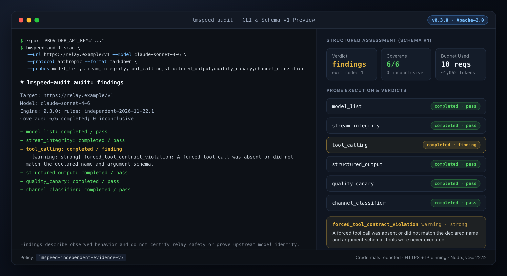
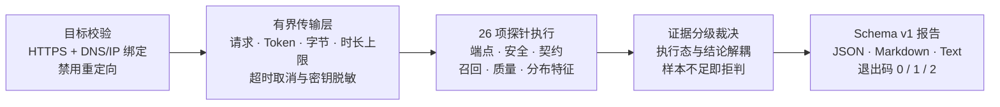

<div align="center">

# lmspeed-audit

**面向 LLM API 与中转接口的循证式审计 SDK 与 CLI — 校验协议规范、工具与结构化输出契约、提示词隔离、上下文召回及行为一致性。**

[](https://github.com/nexmoe/lmspeed-audit/actions/workflows/ci.yml)
[](./LICENSE)
[](./package.json)
[](./package.json)

[English](./README.md) · [简体中文](./README.zh-CN.md)

[核心特性](#核心特性) · [快速上手](#快速上手) · [在线测试](https://lmspeed.net/zh/audit) · [效果预览](#效果预览) · [完整功能参考](#完整功能与探针参考) · [方法论与证据边界](#方法论与证据边界) · [致谢](#致谢) · [许可证](#许可证)

</div>

> [!NOTE]
> **证据边界说明：** 审计报告将执行状态（`completed`、`blocked`、`unsupported`、`skipped`、`error`）、探针结论（`pass`、`finding`、`inconclusive`）、置信度（`weak`、`moderate`、`strong`）与覆盖率严格分离。可观测的契约异常、响应头线索或封闭集排序均不能证明真实上游模型或运营方意图；`no_findings` 仅代表所测负载下未发现异常，不构成安全性背书。

---

## 核心特性

- **4 大维度共 26 项模块化探针** — 覆盖端点可达性与响应头线索、提示词与条件注入安全、流式与多模态/工具契约（`tool_calling`、`structured_output`、`image_understanding`、`pdf_understanding`、`context_recall`）及质量与分布一致性（`quality_canary`、`quality_comparison`、`model_fingerprint`、`numeric_fingerprint`、`tokenizer_fingerprint`）。
- **多协议自动路由** — 原生支持 OpenAI Chat（`/chat/completions`）、Anthropic Messages（`/messages`）、OpenAI Responses（`/responses`）及按模型 ID 自动识别的 `auto` 模式。
- **执行状态与判定结论分离** — 未声明的多模态能力、鉴权失败、限流、缺失遥测或未校准的参照基线将归类为 `unsupported`、`blocked`、`skipped` 或 `inconclusive`，绝不混淆为通过或直接判错。
- **防 SSRF 与凭据脱敏保护** — 公开模式强制 HTTPS，每次连接重新解析 DNS 并绑定目标 IP，拦截私有/保留 IPv4 与 IPv6 网段，禁用 HTTP 重定向以防泄露请求头与密钥；密钥仅从环境变量读取，`--output` 严格使用 `0600` 排他创建，并在报告与回调中自动清理密钥和敏感配置赋值。
- **统一共享资源预算** — 目标端点、参照模型及裁判模型请求共同受 `maxRequests`、`maxInputTokens`、`maxResponseBytes`、`maxDurationMs`、`pacingMs` 与 `AbortSignal` 取消控制。
- **留出法基线校准门禁** — `collect-baseline` 在独立训练与验证批次中采集两个候选源及一个外部对照源（`other`），生成 SHA-256 摘要并强制校验时效性与留出间隔，证据不足时自动拒判。

---

## 快速上手

### 在线快速测试（LMSpeed 网页端，免安装）

如果不想在本地配置环境，可直接通过托管相同 `@lmspeed/audit` 引擎的 LMSpeed 网页端立即实测：

- **[发起在线全量审计](https://lmspeed.net/zh/audit)** — 在线提交接口运行多维探针并生成可分享报告
- **单项在线检测** — [模型分布复核](https://lmspeed.net/zh/audit/model-fingerprint) · [流式完整性](https://lmspeed.net/zh/audit/stream-integrity) · [结构化工具调用](https://lmspeed.net/zh/audit/tool-calling) · [上下文召回](https://lmspeed.net/zh/audit/context-recall)
- **更多实用入口** — [API 速度评测](https://lmspeed.net/zh/speed) · [中转与服务商目录](https://lmspeed.net/zh/provider) · [免费测试 API Key](https://lmspeed.net/zh/free-api-keys)

### Agent 快速上手 Prompt（直接复制使用，无需修改）

将下方提示词直接复制给 Claude Code、Codex、Cursor 或任意具备终端执行能力的 Agent，即可引导其向你确认必要信息并完成全流程审计：

```text
请帮我安装并使用 lmspeed-audit（https://github.com/nexmoe/lmspeed-audit）审计一个 LLM API 端点。

1. 使用 Node.js >=22.12，通过 `pnpm add --global @lmspeed/audit` 安装已发布的 CLI，并先运行 `lmspeed-audit --help` 与 `lmspeed-audit list --format json` 确认可用参数和全部探针 ID。单次运行可用 `pnpm dlx @lmspeed/audit --help`；Homebrew、Scoop 和便携下载见安装章节。
2. 在向目标端点发送任何网络请求之前，先向我询问并确认对话中尚未提供的必要信息：
   - 目标 API Base URL（并确认是否为本地或内网 HTTP 服务，需要启用 `--allow-private`）
   - 需要审计的模型 ID
   - 协议类型（`auto`、`openai`、`anthropic` 或 `responses`）
   - 审计档位（`connectivity`、`general`、`web3` 或 `full`）或指定的探针列表，以及可选能力配置（如 `--thinking`、`--context-tokens` 或指向本地 `--config` JSON 文件以配置对照/裁判/上下文/指纹与分词器基线）
   - 存放 API Key 的环境变量名（默认为 `PROVIDER_API_KEY`）。请提醒我在终端自行 `export` 该环境变量，绝对不要让我在聊天框直接粘贴明文密钥。
3. 先用低预算跑通连通性与协议预检（`--profile connectivity --max-requests 10 --format markdown`），确认鉴权和流式协议正常。
4. 预检通过后，再按确认好的档位/探针并带上显式预算上限（`--max-requests`、`--max-duration-ms`）执行扫描；如需保留 JSON 报告，请使用 `--output` 输出到文件，并在全程禁止输出或记录 API Key。
5. 最终向我清晰汇总 `assessment.verdict`、覆盖率明细（`completed` 与 `blocked` / `unsupported` / `skipped` / `inconclusive`）、每条发现的 `severity` 与 `confidence`，以及实际 `usage` 请求和输入 Token 消耗，同时严格遵守证据边界，不依据局部观测推断未证实的真实上游身份或整体安全性。
```

## 安装

CLI 和 SDK 需要 **Node.js >=22.12**。Homebrew 与 Scoop 会自动安装 Node.js。

### npm 注册表

```sh
# 单次运行，无需全局安装
pnpm dlx @lmspeed/audit --help

# 全局安装命令行工具
pnpm add --global @lmspeed/audit
lmspeed-audit list

# 在项目内安装 TypeScript SDK
pnpm add @lmspeed/audit
```

包地址：[`@lmspeed/audit`](https://www.npmjs.com/package/@lmspeed/audit)。

### Homebrew（macOS 与 Linux）

```sh
brew tap nexmoe/lmspeed-audit https://github.com/nexmoe/lmspeed-audit
brew install nexmoe/lmspeed-audit/lmspeed-audit
lmspeed-audit --version
```

本仓库同时提供上游维护的 Homebrew tap。升级使用 `brew update && brew upgrade lmspeed-audit`。

### Scoop（Windows）

```powershell
scoop bucket add lmspeed https://github.com/nexmoe/lmspeed-audit
scoop install lmspeed/lmspeed-audit
lmspeed-audit --version
```

此 bucket 安装便携命令与 `nodejs-lts`，升级使用 `scoop update lmspeed-audit`。

### GitHub Packages

GitHub 的 npm 注册表即使安装公开包也要求鉴权。按 [GitHub 官方文档](https://docs.github.com/en/packages/working-with-a-github-packages-registry/working-with-the-npm-registry) 使用具有 `read:packages` 权限的 classic personal access token 登录，并仅映射 `@nexmoe` scope：

```ini
@nexmoe:registry=https://npm.pkg.github.com
//npm.pkg.github.com/:_authToken=${NODE_AUTH_TOKEN}
```

```sh
pnpm add --global @nexmoe/lmspeed-audit
# 使用别名保留 @lmspeed/audit 的 SDK 导入方式
pnpm add @lmspeed/audit@npm:@nexmoe/lmspeed-audit
```

不要提交令牌。主 npm 包不需要 GitHub 登录。

### 便携下载

[GitHub Releases](https://github.com/nexmoe/lmspeed-audit/releases/latest) 提供 `.tar.gz`、`.zip` 和 `SHA256SUMS`。便携包包含已构建的命令、运行依赖、文档与许可声明。核对校验和后解压，运行 `node lmspeed-audit/lmspeed-audit.mjs --help`，Windows 也可运行 `lmspeed-audit.cmd`。无需安装依赖，但仍需 Node.js。

免安装可直接使用 [LMSpeed 在线审计](https://lmspeed.net/zh/audit)、[LLM 测速](https://lmspeed.net/zh/speed) 与[服务商目录](https://lmspeed.net/zh/provider)。维护者可查看[发布与安装渠道维护文档](./docs/releasing.md)。

### 从源码安装与构建

环境要求：**Node.js `>= 22.12`** 与 **pnpm**：

```sh
git clone https://github.com/nexmoe/lmspeed-audit.git
cd lmspeed-audit
pnpm install --frozen-lockfile
pnpm build
node dist/cli/index.js --help
```

如需在全局命令行直接使用 `lmspeed-audit`：

```sh
pnpm link --global
lmspeed-audit list
```

### CLI 常用命令

```sh
export PROVIDER_API_KEY="sk-your-key-here"

# 1. 快速连通性与流式框架预检
lmspeed-audit scan \
  --url https://relay.example.com/v1 \
  --model claude-sonnet-4-6 \
  --protocol auto \
  --profile connectivity \
  --max-requests 10 \
  --format markdown

# 2. 带预算上限的常规扫描并导出 0600 权限 JSON 报告
lmspeed-audit scan \
  --url https://relay.example.com/v1 \
  --model gpt-4o \
  --profile general \
  --max-requests 120 \
  --max-duration-ms 180000 \
  --format json \
  --output audit-report.json
```

### TypeScript SDK 调用

```ts
import { ENGINE_VERSION, runAudit } from '@lmspeed/audit';

const report = await runAudit(
  {
    target: {
      baseUrl: 'https://relay.example.com/v1',
      modelId: 'claude-sonnet-4-6',
      protocol: 'auto',
    },
    apiKey: process.env.PROVIDER_API_KEY!,
    profile: 'general',
    capabilities: { vision: true },
  },
  {
    limits: { maxRequests: 100, maxDurationMs: 120_000 },
    pacingMs: 100,
  },
);

console.log(ENGINE_VERSION, report.assessment.verdict, report.coverage);
```

---

## 效果预览



- **CLI 退出码：** `scan` 返回 `0`（`no_findings`）、`1`（`findings`）或 `2`（`inconclusive`、缺少凭据参数或运行错误）；`collect-baseline` 在校准状态为 `validated` 时返回 `0`，否则返回 `2`。

<details>
<summary>Schema v1 JSON 输出节选（v0.3.0 本地回环实测输出）</summary>

```json
{
  "schemaVersion": "1",
  "engineVersion": "0.3.0",
  "rulesetVersion": "independent-2026-11-22.1",
  "target": {
    "baseUrl": "http://127.0.0.1:57215/v1",
    "modelId": "claude-sonnet-4-6",
    "protocol": "anthropic"
  },
  "probes": [
    {
      "id": "tool_calling",
      "execution": "completed",
      "verdict": "finding",
      "findings": [
        {
          "probeId": "tool_calling",
          "code": "forced_tool_contract_violation",
          "severity": "warning",
          "confidence": "strong",
          "evidence": "A forced tool call was absent or did not match the declared name and argument schema."
        }
      ]
    },
    {
      "id": "channel_classifier",
      "execution": "completed",
      "verdict": "pass",
      "observations": {
        "status": 200,
        "channel": "anthropic-api",
        "confidence": 0.5,
        "evidence": ["anthropic-ratelimit-requests-limit"]
      }
    }
  ],
  "coverage": {
    "requested": [
      "model_list",
      "stream_integrity",
      "tool_calling",
      "structured_output",
      "quality_canary",
      "channel_classifier"
    ],
    "completed": [
      "model_list",
      "stream_integrity",
      "tool_calling",
      "structured_output",
      "quality_canary",
      "channel_classifier"
    ],
    "inconclusive": [],
    "blocked": [],
    "unsupported": [],
    "skipped": []
  },
  "assessment": {
    "policyId": "lmspeed-independent-evidence-v3",
    "verdict": "findings"
  },
  "usage": {
    "requests": 18,
    "inputTokensEstimated": 1062
  }
}
```

</details>

---

## 完整功能与探针参考

### 审计档位与协议模式

| 档位（`profile`） | 默认启用的探针 | 适用场景 |
| :--- | :--- | :--- |
| `connectivity` | `model_list`、`stream_integrity` | 快速验证端点可达性、鉴权、模型目录与 SSE 流格式 |
| `general` *(默认)* | 全部 17 项自动探针（覆盖端点、提示词安全、完整性与质量），不包含 `web3_prompt_injection` 及需额外配置的可选探针 | 日常标准中转契约与安全审计 |
| `web3` | `general` 集合 + `web3_prompt_injection` + 已配置的可选探针 | 在常规审计基础上增加钱包助记词/私钥保护策略校验 |
| `full` | 同类自动探针 + `web3_prompt_injection` + 全部已配置的能力/参照探针（`tokenBaselines`、`vision`、`pdf`、`context`、`reference`、`identity`、`numericFingerprint`、`tokenizer`） | 结合完整本地配置的深度审计 |

| 协议（`protocol`） | 路由端点与鉴权头 | `auto` 识别规则 |
| :--- | :--- | :--- |
| `openai` | `POST /chat/completions`、`GET /models`、`Authorization: Bearer <key>` | `modelId` 不匹配 `claude` 时的默认协议 |
| `anthropic` | `POST /messages`、`x-api-key: <key>`、`anthropic-version: 2023-06-01` | 当 `modelId` 匹配 `/claude/i` 时自动选用 |
| `responses` | `POST /responses`、`Authorization: Bearer <key>` | 需通过 `--protocol responses` 显式指定 |
| `auto` | 按上述规则自动切换 OpenAI / Anthropic | CLI 与 SDK 默认值 |

### 全部 26 项探针矩阵

#### 1. 端点画像（`endpoint_profile`）

| 探针 ID | 触发方式 | 检测内容与证据边界 |
| :--- | :--- | :--- |
| `infrastructure_recon` | 自动 | 检查入口 HTTP 可达性、状态码与 `content-type`；不执行 DNS、证书链或域名所有权审计 |
| `model_list` | 自动 / `connectivity` | 请求 `GET /models` 的 `data[]` 目录并核对目标 `modelId` 是否在声明列表中 |
| `infrastructure_fingerprint` | 自动 | 发送短响应测试并记录有限的非识别性响应头线索 |
| `channel_classifier` | 自动 | 识别显式响应头前缀（`cf-aig-`、`x-amzn-bedrock-`、`anthropic-ratelimit-`），缺失或冲突时判为 `inconclusive` |

#### 2. 提示词与注入安全（`prompt_security`）

| 探针 ID | 触发方式 | 检测内容与证据边界 |
| :--- | :--- | :--- |
| `token_injection` | 可选（`capabilities.tokenBaselines`） | 比对 `plain`、`system`、`question` 模板下的实报输入 Token 数与校准值（`reported_input_count_mismatch`） |
| `prompt_extraction` | 自动 | 在系统指令中注入随机生成的 `PRIVATE_*` 受保护值，检查是否直接泄漏原文或 Base64 编码（`protected_value_disclosed`） |
| `jailbreak_identity` | 自动 | 以 JSON 与 Base64 格式请求输出随机受保护值，检验指令边界泄漏 |
| `conditional_injection` | 自动 | 随机顺序执行 3 组“普通账户 vs 敏感账户”对照任务，检测是否仅在敏感任务中异常泄漏 `DECOY_*` 与外发 `https://` 引导 |
| `web3_prompt_injection` | `web3` / `full` | 使用结构化 JSON 验证面对要求上传助记词的诱导是否返回拒绝策略（`{"action":"reject"}`） |

#### 3. 模型鉴真与一致性（`model_authenticity`）

| 探针 ID | 触发方式 | 检测内容与证据边界 |
| :--- | :--- | :--- |
| `instruction_conflict` | 自动 | 系统消息要求精确返回随机 `ACK_*`，用户消息要求忽略前文计算乘法，检测优先级服从性（`system_priority_mismatch`） |
| `stream_integrity` | 自动 / `connectivity` | 校验 SSE 事件结构、终结符（`[DONE]` / `message_stop` / `response.completed`）、流式模型名一致与用量单调递增 |
| `context_window` | 自动 *（依赖配置）* | 若配置 `context.sizes` 或 `contextWindowTokens`，则以 `Math.min(16384, tokens * 2)` 进行有限召回抽样；未配置则报 `unsupported` |
| `context_recall` | 可选（`context`） | 在默认 `[0, 0.25, 0.5, 0.75, 1]` 等位置埋入随机 `FACT_*` 标记并在漏检时复核一次，确认 `context_recall_missing` |
| `model_fingerprint` | 可选（`identity`） | 与经过验证的留出基线比对输出分布；样本不足、过期、配置不兼容或间隔不够时拒判 |
| `numeric_fingerprint` | 可选（`numericFingerprint`） | 校验本地 `shared_detector.bin` SHA-256 与有效期（`1–90` 天，默认 `30`），借助 `lmfpd-sdk` 输出封闭集候选排序 |
| `tokenizer_fingerprint` | 可选（`tokenizer`） | 使用外部 MIT `TokenizerBank` 进行自适应贝叶斯后验测试（阈值 `0.99`），首尾空提示词发生计数漂移时拒判 |

#### 4. 响应完整性与稳定性（`response_integrity_stability`）

| 探针 ID | 触发方式 | 检测内容与证据边界 |
| :--- | :--- | :--- |
| `tool_substitution` | 自动 | 要求原样复述随机 `@audit-fixture/*` 包安装命令并检测篡改，全程不执行命令（`literal_output_mismatch`） |
| `error_leakage` | 自动 | 发送单次畸形 JSON 请求 `{`，扫描响应体/头中的敏感配置赋值（如 `DATABASE_URL`、`API_KEY`），不保留密钥值 |
| `latency_variance` | 自动 | 顺序发起 5 次短请求，输出客观耗时统计（`count`、`median`、`mean`、`min`、`max`、`spread`） |
| `tool_calling` | 自动 *（除非 `tools: false`）* | 检查强制调用参数契约（`audit_weather`）、禁用工具与未声明工具时的收敛表现，工具永不实际执行 |
| `structured_output` | 自动 *（除非 `structuredOutput: false`）* | 通过 2 组随机 `nonce` 检验 `strict` 模式及 `additionalProperties: false` 严格 JSON Schema 遵循度 |
| `image_understanding` | 可选（`capabilities.vision: true`） | 动态生成仅存在于图像字节中的纯色块 PNG 并校验英文颜色词识别结果 |
| `pdf_understanding` | 可选（`capabilities.pdf: true`） | 动态生成包含随机单词的真实 PDF 文档字节并核对提取准确性 |
| `stream_consistency` | 自动 | 对同一确定性请求对比流式与非流式响应的模型标识、输入计数及非推理输出 Token 计数 |
| `quality_canary` | 自动 | 执行内置 10 道确定性微测试题（`QUALITY_TASKS`：算术、排序、反转、JSON、格式、质数、二进制、Python 长度、逻辑与词记忆） |
| `quality_comparison` | 可选（`reference`，可选 `judge`） | 在目标端与双参照请求间随机打乱顺序对照 `QUALITY_TASKS`，将采集故障与质量回归严格区分 |

### CLI 参数与默认限额

```sh
lmspeed-audit scan --url <base-url> --model <model-id> [options]
lmspeed-audit collect-baseline --config collection.json [--output baseline.json]
lmspeed-audit list [--format json]
```

| 参数 | 默认值 | 说明 |
| :--- | :--- | :--- |
| `--url`、`--model` | *(`scan` 必填)* | 目标 API Base URL 与模型标识符 |
| `--protocol` | `auto` | `auto`、`openai`、`anthropic` 或 `responses` |
| `--profile` | `general` | `connectivity`、`general`、`web3` 或 `full` |
| `--probes` | 按档位决定 | 逗号分隔的探针 ID 列表（可通过 `list` 查看） |
| `--format` | `json` | `scan` 支持 `json`、`markdown`、`text`；`list` 支持 `json` |
| `--output` | 标准输出 | 以 `0600` 权限写入新文件（`wx`，若文件已存在则报错避免覆盖） |
| `--config` | — | 本地配置文件路径，配置能力标记、上下文尺度、对照/裁判或指纹基线 |
| `--key-env` | `PROVIDER_API_KEY` | 读取目标 API 密钥的环境变量名 |
| `--allow-private` | `false` | 允许访问纯 HTTP 及内网/回环调试地址 |
| `--thinking` | `false` | 在能力描述中声明支持扩展思考 |
| `--context-tokens` | — | 预期上下文长度（正整数），供 `context_window` 在未指定 `context.sizes` 时使用 |
| `--max-requests` | `200` | 目标、参照及裁判请求共享的总请求数上限 |
| `--max-input-tokens` | `2000000` | 预估总输入 Token 上限（按 `ceil(body.length / 4)` 累计） |
| `--max-response-bytes` | `4000000` | 单次 HTTP 响应体最大缓存字节数 |
| `--max-duration-ms` | `600000` | 整次扫描的最大执行时长（毫秒） |
| `--pace-ms` | `0` | `latency_variance` 请求间隔等待时间（毫秒） |

### 配置文件（`--config`）、基线采集与包导出

通过 `--config` 传入的配置文件严禁出现明文 `apiKey`（须使用 `apiKeyEnv` 指定环境变量），相对路径按配置文件所在目录解析：

```json
{
  "profile": "full",
  "capabilities": {
    "vision": true,
    "pdf": false,
    "tokenBaselines": { "plain": 14, "system": 24, "question": 18 }
  },
  "context": {
    "sizes": [4096, 16384],
    "positions": [0, 0.5, 1]
  },
  "reference": {
    "target": { "baseUrl": "https://ref.example.com/v1", "modelId": "gpt-4o", "protocol": "openai" },
    "apiKeyEnv": "REFERENCE_API_KEY"
  },
  "judge": {
    "target": { "baseUrl": "https://judge.example.com/v1", "modelId": "gpt-4o", "protocol": "openai" },
    "apiKeyEnv": "JUDGE_API_KEY",
    "minimumScore": 7
  },
  "identity": {
    "baselineFile": "./artifacts/baseline.json",
    "claimedModel": "candidate-a"
  },
  "tokenizer": {
    "bankFile": "./artifacts/tokenizer-bank.json",
    "maximumProbes": 20,
    "maxAgeDays": 30
  },
  "numericFingerprint": {
    "dataDirectory": "./artifacts/numeric",
    "detectorSha256": "64-lowercase-hex-sha256-of-shared-detector-bin",
    "maximumAgeDays": 30
  }
}
```

使用 `collect-baseline`（或 SDK 的 `collectFingerprintBaseline`）需配置至少 2 个 `candidate` 源和 1 个 `other` 外部参照源（`2–8` 个不重复提示词、每题 `16–256` 次采样、`maxOutputTokens` `16–2048`、`maxAgeDays <= 30`）。

包导出入口：`@lmspeed/audit`（主 SDK）、`@lmspeed/audit/catalog` *（浏览器可用）*、`@lmspeed/audit/schema` *（浏览器可用）*、`@lmspeed/audit/legacy-types` *（浏览器可用）*、`@lmspeed/audit/compat`、`@lmspeed/audit/classifiers`、`@lmspeed/audit/sse`、`@lmspeed/audit/model-family`、`@lmspeed/audit/prompts` 与 `@lmspeed/audit/redaction`。

---

## 方法论与证据边界



1. **防 SSRF 与凭据零泄露** — `validateTarget` 在每次出站前解析主机地址并校验 IPv4/IPv6 公网合法性，直接连接解析 IP 且关闭 HTTP 重定向；序列化报告和 stderr 异常输出都会剔除所有输入密钥及敏感 URL/配置赋值。
2. **执行状态与判定解耦** — 将鉴权拦截、限流、未启用功能、缺少细分计费字段及过期参照分别标记为 `blocked`、`unsupported`、`skipped` 或 `inconclusive`，避免误判。
3. **统计学克制与留出检验** — 行为分布指纹要求协议/生成参数严格一致、独立留出校验与有效间距阈值；分词器检测包含前后空提示词漂移检查和 `0.99` 后验停止条件。
4. **本地工程验证（`pnpm check`）** — 依次执行 TypeScript 编译、Biome 代码规范检查、严格类型检查、AST 测试治理检查（禁止 mock、强制 `Given/When/Then` 与 `user ` 用户场景命名）、基于真实回环 HTTP 的 Vitest 测试套件（要求 `>= 70%` 分支覆盖率）及包边界验证 `pnpm verify:package`。自动测试针对真实回环服务端校验契约实现，一手线上模型识别准确率需由使用方配合校准基线另行评估。参见 [`docs/acceptance.md`](./docs/acceptance.md) 与 [`docs/strategy-review.md`](./docs/strategy-review.md)。

---

## 致谢

- **[LMSpeed](https://lmspeed.net)** — 维护 `@lmspeed/audit` 的 LLM API 速度与质量基准评测平台。
- **[lm-detector](https://github.com/Ikaleio/lm-detector) 与 [lmfpd-sdk](https://www.npmjs.com/package/lmfpd-sdk)** — 提供遵循 MIT 许可的分词器贝叶斯后验规划及离线数字序列指纹排序实现（完整版权声明见 [`THIRD_PARTY_NOTICES.md`](./THIRD_PARTY_NOTICES.md)）。
- **开放协议与安全研究** — 流式分析与行为测试参考公开的 OpenAI、Anthropic、WHATWG SSE 规范、Web3 提示词安全研究（`arXiv:2604.08407`），以及社区在模型核验方向上的公开方法（如 `LLMprobe-engine`、`Veridrop`、`meow-llm-detector`）。

---

## 许可证

本项目基于 **[Apache License, Version 2.0](./LICENSE)**（`Apache-2.0`）开源。详见 [`LICENSE`](./LICENSE)、[`NOTICE`](./NOTICE) 与 [`THIRD_PARTY_NOTICES.md`](./THIRD_PARTY_NOTICES.md)。
